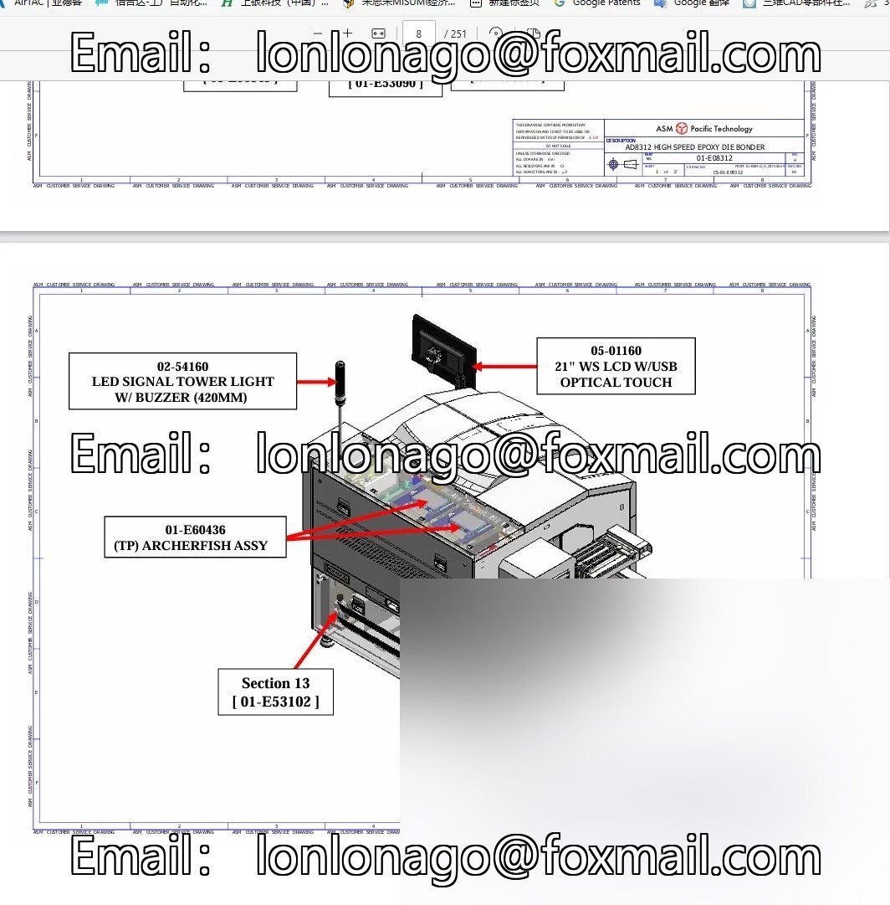
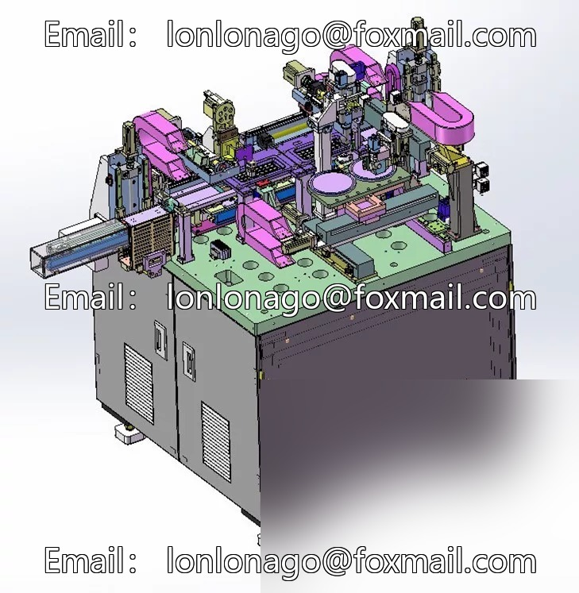
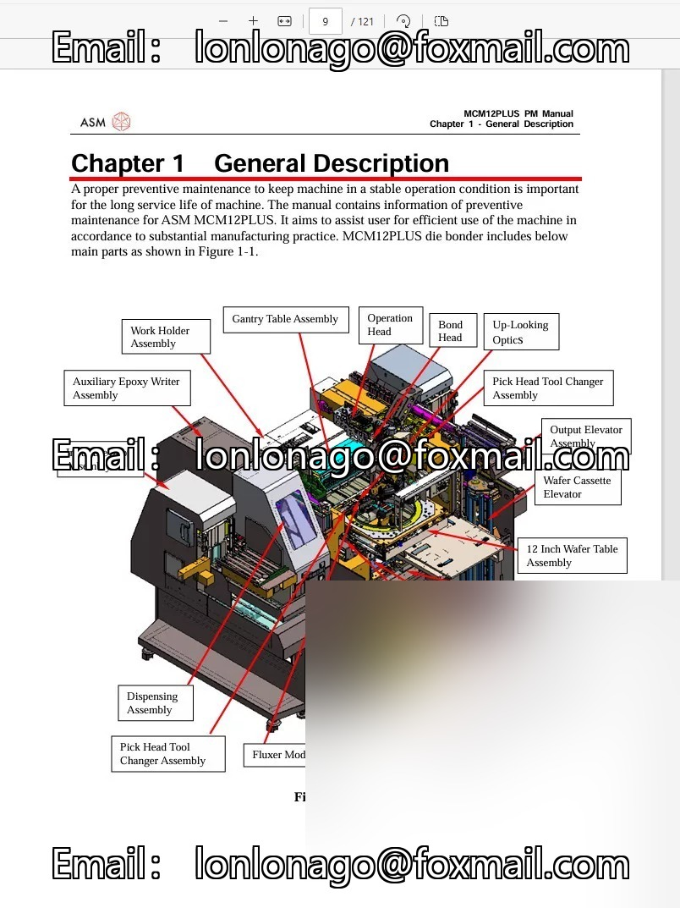
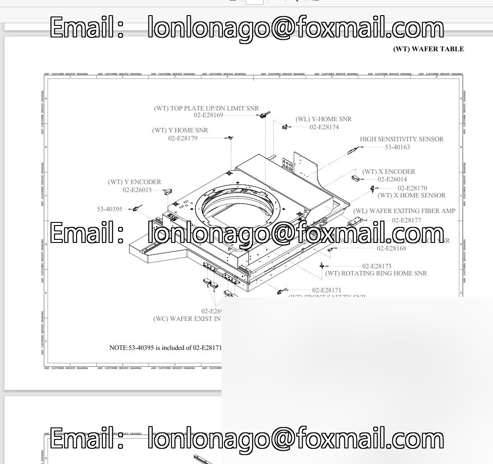

# ASMAD8312 repairs and exploded diagrams for 3D drawings of the giga-crystal machine

## Body

Solid Crystal Machine 3D Drawing - ASMAD8312 Maintenance Manual and Explosion Drawing

ASM-AD8312 firmware manufacturing machine maintenance manual and assembly explosion diagram - gift other industry firmware manufacturing 3D drawings; this material is extremely valuable! It has significant reference value for the research of firmware manufacturing machines, high-speed high-precision equipment structures; the structures within are clear at a glance, providing very referential significance for studying details design and precision requirements; it contains firmware manufacturing machine SW drawings of other industries!

Capture and send the electronic original directly! The following images include screenshots of the file portion. Please confirm before placing the order! Due to the replicable nature of electronic documentation Therefore, are allowed after purchase! Thanks for understanding!

For personal learning and reference use only.

The materials include 3D drawings of a solid crystal machine, ASMAD8312 maintenance manual, exploded diagrams and related industry drawings, plus copyable electronic files, intended for personal learning and reference.

<!-- AI_ENRICHED -->

## Images

## Payment

Here is a pay link on Stripe ( https://buy.stripe.com/3cs8yP7sY87d0vu9AB ). Please contact me lonlonago@foxmail.com after funding $89, and I will send you a complete data files , thank you!

